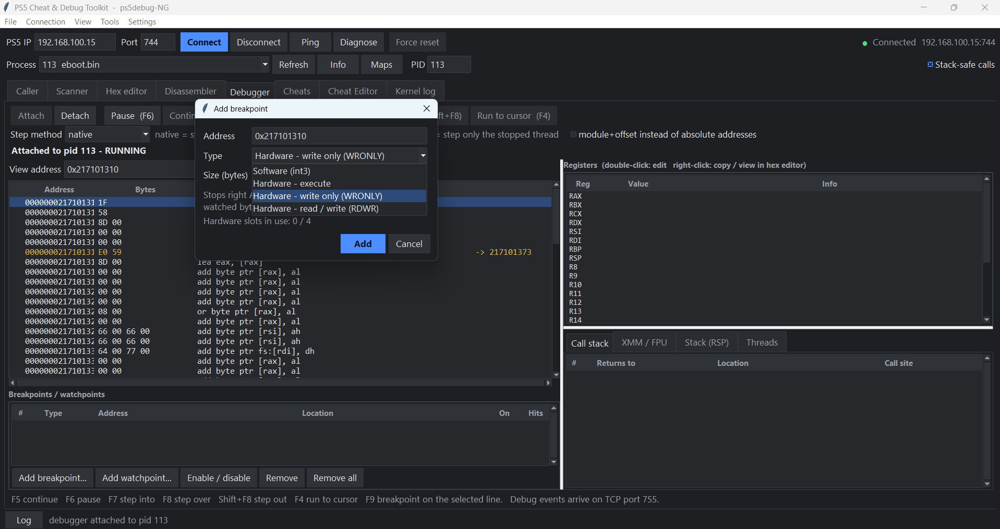
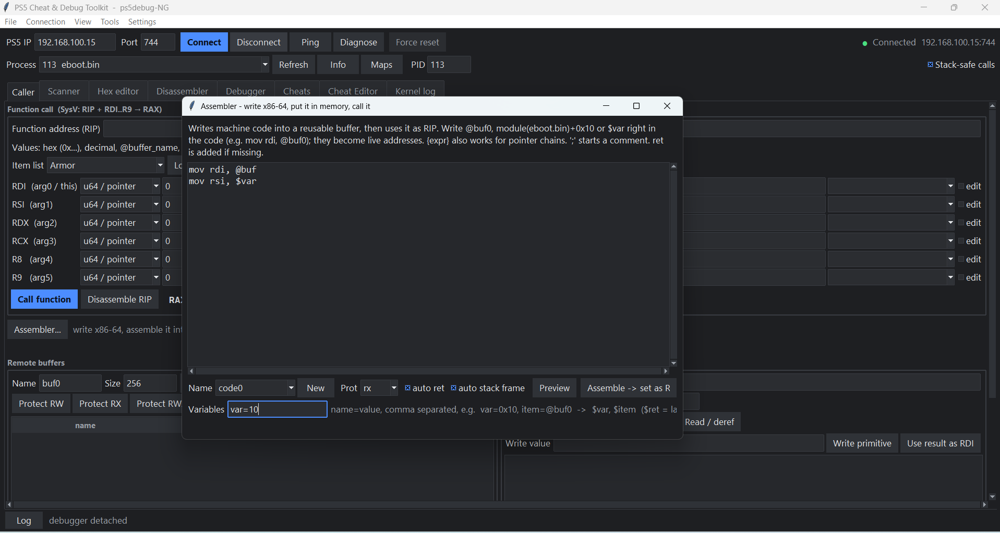

<p align="center">
  
</p>

<h1 align="center">PS5 Cheat & Debug Toolkit</h1>

<p align="center">
  An all-in-one PlayStation 5 memory scanner, debugger, disassembler and cheat maker for
  <a href="https://github.com/Pharaoh2k/ps5debug-NG">ps5debug-NG</a>, in the spirit of Cheat Engine.
</p>

<p align="center">
  
</p>

---

## What it does

| | |
| --- | --- |
| **Scan memory** | Exact, bigger / smaller, between, unknown initial, increased / decreased, changed / unchanged - run on the console (turbo scan); address list with freeze; Cheat Engine-style **pointer scan** |
| **Read & patch** | Hex editor, disassembler with AOB signatures, assemble-in-place, NOP, code caves and hooks |
| **Debug** | Software and hardware breakpoints, watchpoints, stepping, registers + XMM, call stack that also works through frameless functions, threads |
| **Call game functions** | Call any function with up to 6 arguments, allocate buffers, write assembly into memory and run it |
| **Log calls** | Function logger: every call to a function with its arguments and caller, without stopping the game |
| **Make cheats** | Cheat editor, record a cheat from what you did in the Caller tab, Python steps, item ID lists, projects |
| **Share cheats** | Export to this tool's pack / share code, or to **.shn, .mc4 and GoldHEN .json** for the console cheat menus; import all of those plus decrypted ShnExt projects |
| **Script it** | Built-in Python editor with a `ps5` API (`ps5.aob`, `ps5.pointer`, `ps5.alloc`, `ps5.call`, `ps5.hook` ...) |
| **Watch the console** | Kernel log tab (klog) with error highlighting |

## Contents

- [Requirements](#requirements)
- [Getting started](#getting-started)
- [Tour of the tool](#tour-of-the-tool)
- [Cheats](#cheats)
- [Building the .exe](#building-the-exe)
- [Project layout](#project-layout)
- [Payload notes](#payload-notes)
- [Credits](#credits)

## Requirements

- A PS5 running the **ps5debug-NG** payload (ports 744 commands, 755 debug events, 3232 klog).
- Windows 10/11 (the tool is plain Python + Tk, so Linux/macOS work for most features).
- **Python 3.10+** with Tk (the python.org installer includes it), or the prebuilt `.exe` from Releases.
- Python packages: `capstone` (disassembly), `keystone-engine` (assembler), `numpy` (pointer scan).

```bat
pip install -r requirements.txt
```

## Getting started

1. Load ps5debug-NG on the console.
2. Start the tool: `python gui.py` (or run `PS5 Debug Toolkit.exe`).
3. On the first start it asks for your **author name** - it goes on the cheats you make.
4. Type the console IP, press **Connect**, pick the game in **Process** (it fills in the PID).

Everything the tool saves (settings, cheats, tables, scripts, pointer scans) lives next to `gui.py` /
the exe.

## Tour of the tool

### Scanner

Cheat Engine-style value scanner. Scans run on the console (turbo scan), so a first scan over ~10 GB of
game memory takes a few seconds. Right-click a result to change it, freeze it, browse it in the hex
editor, find what writes or accesses it, or start a pointer scan.

 

### Pointer scan

Finds pointer chains like `"eboot.bin"+278E330 -> 18 -> CE38` that lead to your value after a
restart. With the pointer-scan payload command each level is one pass on the console (a 5-level scan
in under a minute); without it the tool falls back to turbo scans. Results can be rescanned after a
restart and added to the address list or a cheat.


### Hex editor

Paged hex view with typed cursor values, selection copy in several formats, write changes / revert,
dump a region to a file.


### Disassembler

capstone disassembly with back/forward navigation, AOB scan and *Make AOB from selected line*. Right
click to set breakpoints, NOP, patch bytes, assemble in place, build a code cave, log calls or find
references.

 

 

### Debugger

Attach, pause, step into / over / out, run to cursor. Software breakpoints, up to 4 hardware
breakpoints and watchpoints (execute / write / read-write). Registers (editable), XMM/FPU, stack,
threads and a call stack that unwinds through functions without frame pointers and shows each
frame's function start.

 

### Function logger

Hooks a function with a small code cave that copies the registers, return address and stack
arguments into a ring buffer - the game keeps running. See every call, who made it and with which
arguments; group by caller, export CSV.


### Caller

Call any game function (SysV: RDI, RSI, RDX, RCX, R8, R9 -> RAX) with integers, pointers, buffers or
items from an item list. Allocate remote buffers and write strings / bytes into them. The assembler
writes x86-64 into a buffer and calls it.

 


### Python scripting

`Tools > Python script` (Ctrl+P). The `ps5` object wraps the running game; the API list on the right
inserts calls on double-click. Scripts can be saved into a cheat as a Python step.

```python
base = ps5.module()                               # eboot.bin
hp = ps5.pointer(base + 0x4A1C00, 0x20, 0x1C4)
ps5.write_u32(hp, 999, undo=True)                 # restored when the cheat is turned off
site = ps5.aob("48 8B 05 ?? ?? ?? ?? 8B 40 1C")
buf = ps5.alloc("stats", 64, init=bytes([99]) * 64)
ps5.call(base + 0x123450, buf, 64)
```


### Kernel log and log window

The Kernel log tab streams `/dev/klog` (TCP 3232) - crashes, page faults and errors show in red, which
helps when a call or a cheat makes the game close. The log window shows everything the tool did.

 

## Cheats

### Playing cheats

The **Cheats** tab lists your games and their cheats - one row each with On/Off or Run, inputs inline
(for example an item name picked from an item ID list), search across all games and *Turn all off*.


### Making cheats

The **Cheat Editor** edits cheat files (JSON, one per game). A cheat is a list of steps:

```json
{
  "name": "Infinite Health", "mode": "toggle",
  "steps": [ { "op": "patch", "addr": "module(eboot.bin)+0x751BF8", "type": "hex", "value": "90 90 90 90" } ]
}
```

Steps include `write`, `patch`, `asmpatch`, `alloc`, `code`, `hook`, `aob`, `call`, `read`, `set`,
`check`, `python` and more; addresses can use `module(...)`, `@buffer`, `$input` and `[pointer]`
expressions. *Check & fix* finds missing buffers, and **Record cheat from Caller tab** turns a function
call you tested (with its buffers and hex edits) into a cheat, ticked registers becoming inputs.

 

**Projects** keep everything for a set of games in one folder: the game cheat files, the `items\` ID
lists and the `exports\` folder. Switch, create or open projects at the top of the Cheat Editor.

### Exporting

**Export...** asks for the file type:

| Type | Keeps | Use it for |
| --- | --- | --- |
| `.ps5c` pack / share code / tool JSON | everything, plus the item ID lists the cheats use | sharing with users of this tool or the Cheat Player |
| `.shn` | on/off byte patches | GoldHEN / etaHEN cheat menus |
| `.mc4` | same as `.shn`, encrypted | cheat menus that load `.mc4` |
| GoldHEN `.json` | on/off patches and buttons | GoldHEN / etaHEN cheat menus |

The console cheat formats can only hold fixed patches of the game executable, so every cheat is
checked first. Cheats that use code caves allocated at run time, hooks, AOB scans, pointers, inputs or
Python are listed with the reason and left out - nothing is written half-converted. Missing *off*
values (the original bytes) can be read straight from the running game. Files are named
`TITLEID_VERSION.ext` as the cheat menus expect.

## Building the .exe

```bat
build_tool.bat            :: one file:  dist\PS5 Debug Toolkit.exe
build_tool.bat folder     :: a folder, starts faster
```

The script installs PyInstaller and the packages if needed, includes every module of the tool and
the icon, and on the first build copies your `cheats`, `tables`, `scripts`, `pointerscans` and
`settings.json` next to the exe.

## Project layout

| File | What it is |
| --- | --- |
| `gui.py` | Main window, Caller tab, menus |
| `ps5debug_client.py` | ps5debug-NG protocol client |
| `scanner_tab.py`, `pointer_scan.py`, `pointer_scan_dialog.py` | Scanner, address list, pointer scan |
| `hex_view.py`, `disassembler_tab.py`, `disasm.py`, `disasm_view.py` | Hex editor and disassembler |
| `debugger_tab.py`, `debugger_core.py`, `unwind.py` | Debugger, call-stack unwinder |
| `func_logger.py`, `func_logger_window.py` | Function logger |
| `codecave.py`, `codecave_dialog.py`, `asmgen.py`, `aob.py` | Hooks, assembler, AOB signatures |
| `cheats.py`, `cheats_store.py`, `cheats_play_tab.py`, `cheats_editor_tab.py` | Cheat engine and the two cheat tabs |
| `cheat_formats.py`, `cheat_export.py`, `cheat_export_dialog.py`, `cheat_pack.py` | Import / export of cheat formats |
| `cheat_recorder.py`, `cheat_tools.py`, `items.py`, `bulk_items.py`, `projects.py` | Recording, checks, item ID lists, projects |
| `script_api.py`, `script_window.py` | Python scripting |
| `klog_tab.py` | Kernel log |
| `cheat_player/` | Cheat-only player app |
| `assets/` | Icon (`icon.svg` is the source) |

## Payload notes

The tool works with the stock ps5debug-NG payload. One extra command, **pointer-scan level
(`0xBDAACC30`)**, makes pointer scans run on the console; it is submitted upstream as a pull request.
Until a payload has it, the tool detects that it is missing (CAPS bit `TSE_POINTER_SCAN`) and uses
turbo scans instead. or use the payload on https://github.com/alfizari/ps5debug-NG

## Credits

- [ps5debug-NG](https://github.com/Pharaoh2k/ps5debug-NG) - the debug payload this tool talks to
- [capstone](https://www.capstone-engine.org/), [keystone](https://www.keystone-engine.org/), [numpy](https://numpy.org/)
- [ReverseTelnet's PS4/PS5 AIO cheat converter](https://github.com/ReverseTelnet/ps4_ps5_aio_cheat_converter) and the [GoldHEN cheat repository](https://github.com/GoldHEN/GoldHEN_Cheat_Repository) - references for the `.shn` / `.mc4` / `.json` formats
- Cheat Engine - the inspiration

## Disclaimer

For research, reverse engineering and single-player use on hardware you own. Do not use it to cheat
in online games or to break the terms of services you use. Use at your own risk: patching memory or
calling functions can crash the game or the console.
